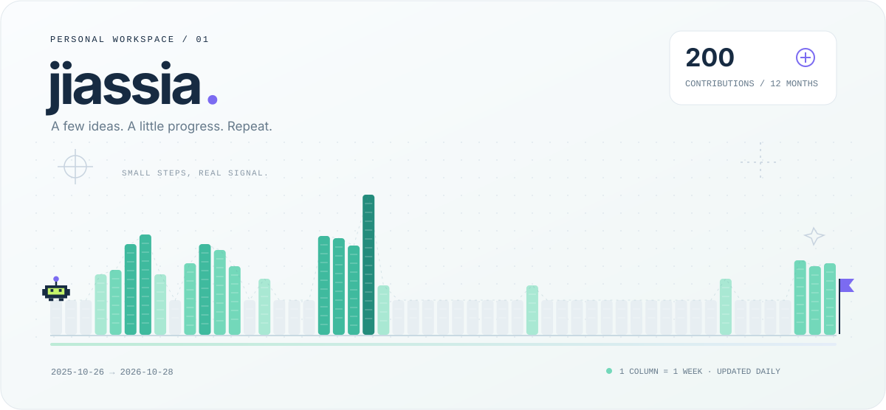

  <a href="https://github.com/jiassia?tab=repositories">Explore the work ↗</a>
  &nbsp;&nbsp;·&nbsp;&nbsp;
  <a href="https://github.com/Willxup/cpa-usage-keeper/pull/681">A recent pull request ↗</a>
  &nbsp;&nbsp;·&nbsp;&nbsp;
  <a href="https://github.com/jiassia#contribution-activity">Follow the trail ↗</a>

  
Behind the pixels

  
Each column represents one week of real GitHub contributions. The rover travels across the resulting landscape, which refreshes daily.

