  

I work on useful tools, clear interfaces, and thoughtful details.

### What I care about

- **Useful tools.** Make everyday workflows easier.
- **Clear interfaces.** Keep controls understandable and data easy to explore.
- **Thoughtful details.** Refine the small interactions that make software pleasant to use.

### Recent contribution

**[Searchable API key filtering](https://github.com/Willxup/cpa-usage-keeper/pull/681)**
Proposed an API key selector for the Request Event Log in `cpa-usage-keeper`, with search, synchronized filters, and export support.

  

### Contribution activity

  <picture>
    <source media="(prefers-color-scheme: dark)" srcset="./assets/github-snake-dark.svg" />
    
  </picture>

Generated from real GitHub contributions and refreshed daily.

